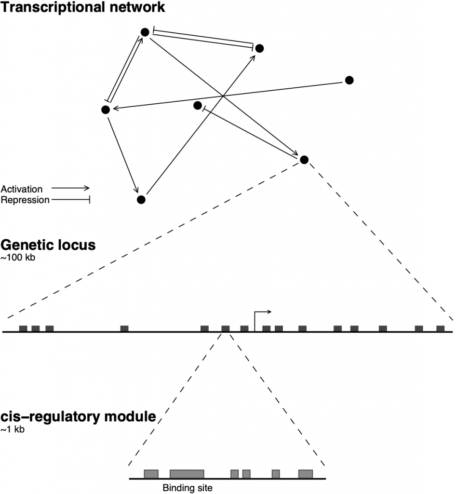

::: {.home-hero}
::: {.hero-copy}
::: {.eyebrow}
UNIVERSITY OF NORTH DAKOTA · BIOLOGY
:::

## The rules of gene regulation underlying cell-fate choice

::: {.hero-description}
How does a cell decide what to become? We combine functional genomics with predictive modeling to understand the gene networks behind cell identity.

We are interested in:

- **The interface of developmental genetics**
- **Genomics**
- **Bioinformatics**
- **Machine learning**
- **Predictive modeling**

:::

::: {.hero-actions}
[Explore our research →](research.qmd){.lab-button .primary}
[Meet the team ↗](team.qmd){.text-link}
:::

:::

::: {.hero-art}
{.network-illustration}
:::
:::

::: {.research-intro}
::: {.section-kicker}
:::

## What we study

We study cell-fate decisions from the logic of individual enhancers to the architecture of entire gene regulatory networks.
:::

::: {.research-grid}
::: {.research-tile}

### Regulatory logic

Discover how transcription factors and enhancers control when genes turn on.

:::
::: {.research-tile}

### Cell-fate decisions

Understand the networks guiding developing blood cells toward distinct identities.

:::
::: {.research-tile}

### Predictive models

Connect time-resolved experiments with dynamical models and machine learning.

:::
:::

::: {.section-heading-row}
::: {.section-heading-copy}
::: {.section-kicker}
:::

## Recent publications
:::

[All publications →](publication.qmd){.text-link}
:::

::: {.featured-paper}
::: {.paper-details}
### [The differentiation of myeloid progenitors is effected by cascading waves of coordinated gene expression that remodel cellular physiology in a characteristic sequence](https://doi.org/10.1371/journal.pcbi.1014276){target="_blank" rel="noopener noreferrer"}

::: {.paper-authors}
Andrea Repele, **Joanna Handzlik**, **Nimasha Samarawickrama**, **Trevor Long**, **Sunil Nooti**, Veena Potluri,Yen Lee Loh, **Manu** 
:::

::: {.paper-journal}
*PLOS Computational Biology · 2026*
:::
:::
:::

::: {.featured-paper}
::: {.paper-details}
### [The contributions of DNA accessibility and transcription factor occupancy to enhancer activity during cellular differentiation](https://doi.org/10.1093/g3journal/jkad269){target="_blank" rel="noopener noreferrer"}

::: {.paper-authors}
**Trevor Long**, **Tapas Bhattacharyya**, Andrea Repele, Madison Naylor, **Sunil Nooti**, Shawn Krueger, **Manu**
:::

::: {.paper-journal}
*G3: Genes, Genomes, Genetics · 2024*
:::
:::
:::
