## Faculties

::: {.team-grid}
::: {.profile-card}
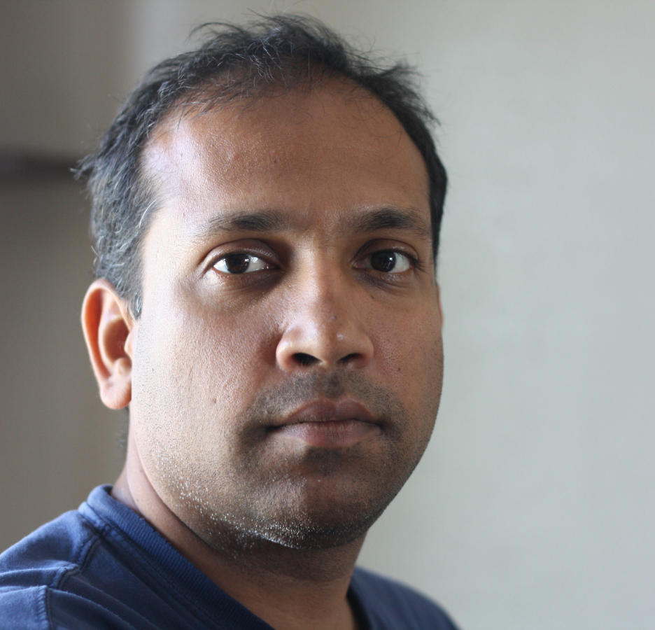{.profile-photo loading="lazy"}

::: {.profile-body}
### Manu, PhD

::: {.profile-role}
Associate Professor
:::

Development, gene regulation, regulatory networks, mathematical modeling, and machine learning.

[manu.manu@und.edu](mailto:manu.manu@und.edu){.profile-email}
:::
:::

::: {.profile-card}
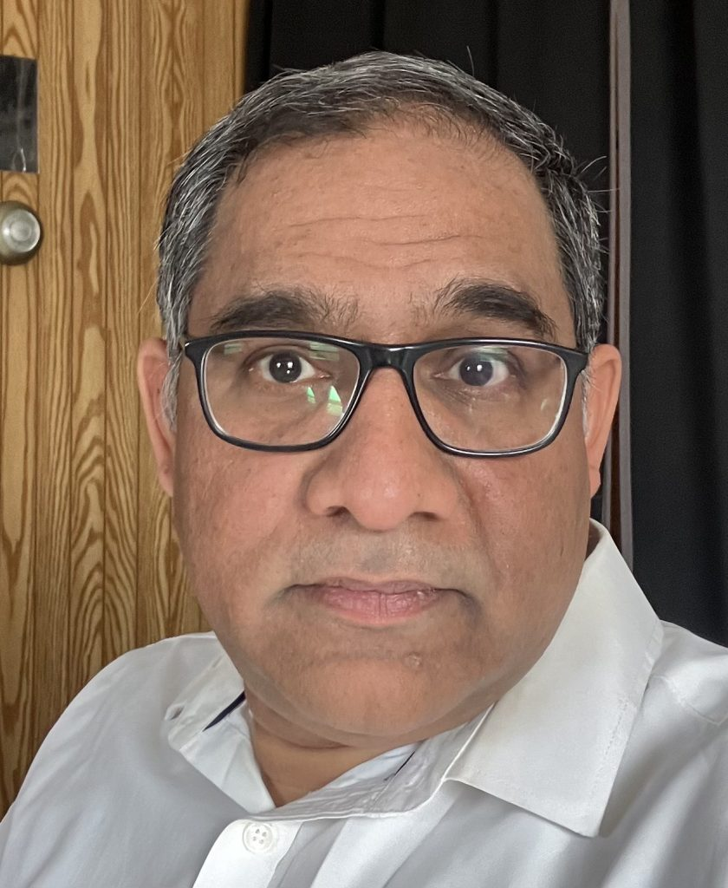{.profile-photo loading="lazy"}

::: {.profile-body}
### Sunil Nooti, PhD

::: {.profile-role}
Research Assistant Professor
:::

Cell-fate regulation, cell-cycle control, and reporter assays.

[sunil.nooti@und.edu](mailto:sunil.nooti@und.edu){.profile-email}
:::
:::
:::

## Graduate students

::: {.team-grid}

::: {.profile-card}
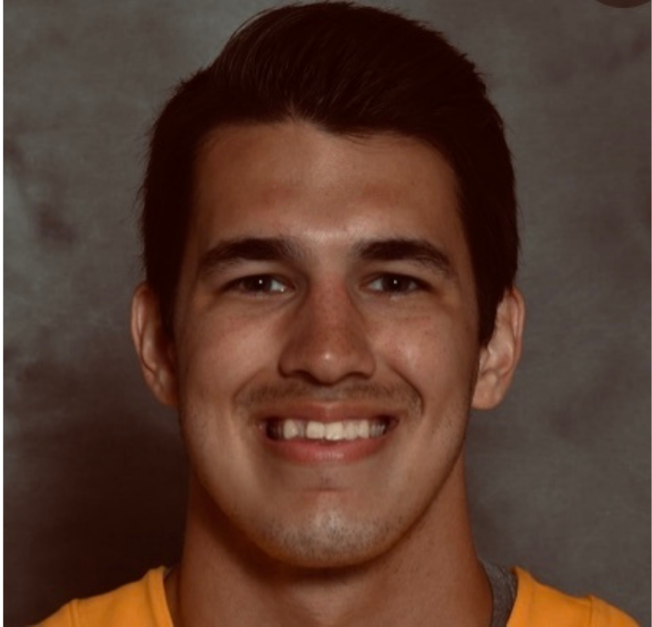{.profile-photo loading="lazy"}

::: {.profile-body}
### Trevor Long

::: {.profile-role}
PhD Student 
XXXX - Present
:::

Functional genomics and gene regulation during cell-fate choice.

[trevor.long@und.edu](mailto:trevor.long@und.edu){.profile-email}
:::
:::

::: {.profile-card}
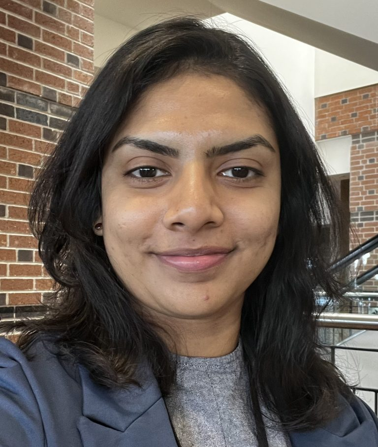{.profile-photo loading="lazy"}

::: {.profile-body}
### Nimasha Samarawickrama

::: {.profile-role}
PhD Student 
XXXX - Present
:::

Physics and machine learning approaches to hematopoietic regulatory networks.

[n.samarawickrama@und.edu](mailto:n.samarawickrama@und.edu){.profile-email}
:::
:::

::: {.profile-card}
{.profile-photo loading="lazy"}

::: {.profile-body}
### Suhyeong Jeon

::: {.profile-role}
PhD Student 
XXXX - Present
:::

Computational biology

[suhyeong.jeon@und.edu](mailto:n.samarawickrama@und.edu){.profile-email}
:::
:::
:::

## Undergraduate students

::: {.team-grid}

::: {.profile-card}
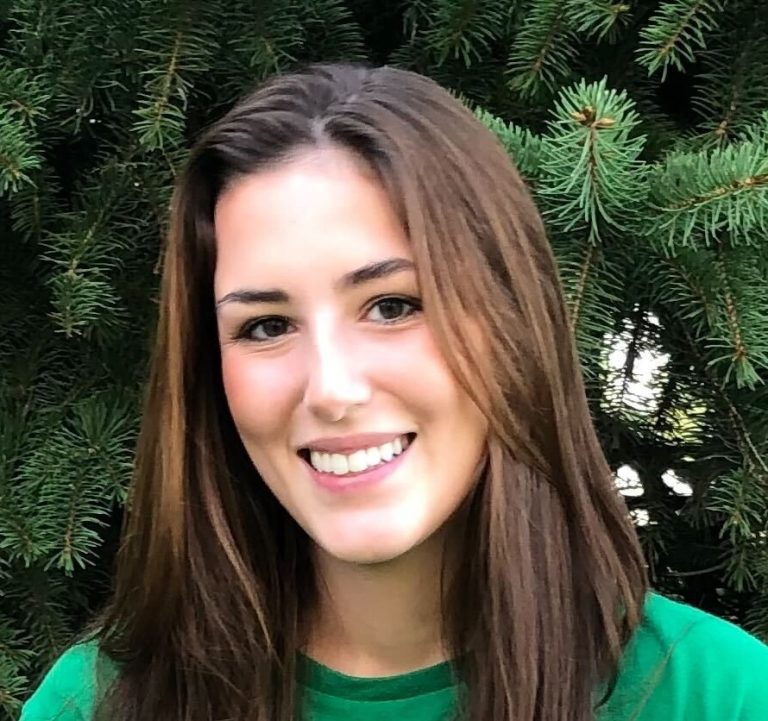{.profile-photo loading="lazy"}

::: {.profile-body}
### BayLee Schlothauer

::: {.profile-role}
Undergraduate Research Assistant
:::

Enhancer function during myeloid differentiation.

[baylee.schlothauer@und.edu](mailto:baylee.schlothauer@und.edu){.profile-email}
:::
:::

::: {.profile-card}
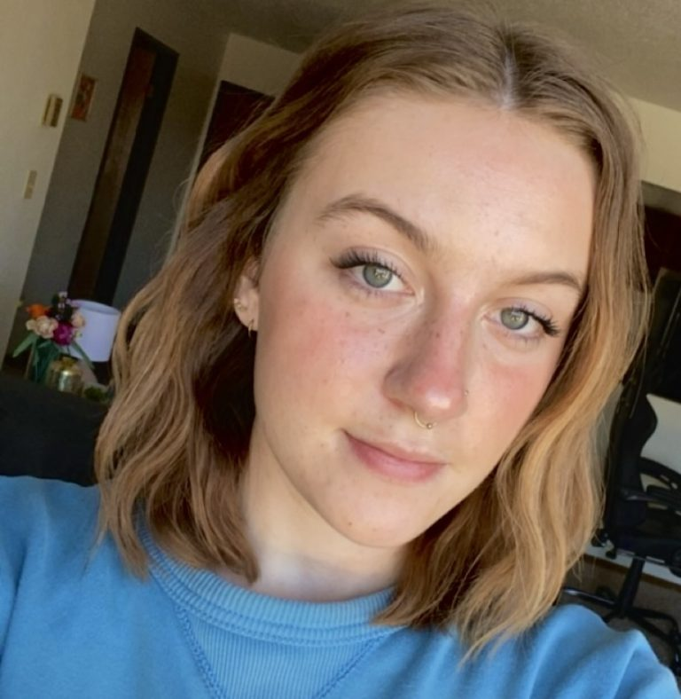{.profile-photo loading="lazy"}

::: {.profile-body}
### Rylie Fode

::: {.profile-role}
Undergraduate Research Assistant
:::

CRISPR-based studies of regulatory elements at the Cebpa locus.

[rylie.fode@und.edu](mailto:rylie.fode@und.edu){.profile-email}
:::
:::

:::

::: {.section-heading-row}
::: {.section-heading-copy}

## Alumni
:::
:::

::: {.alumni-grid}

::: {.alumni-entry}
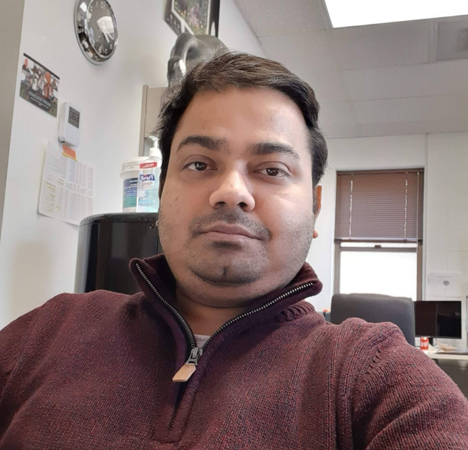{.alumni-photo loading="lazy"}

::: {.alumni-body}
### Tapas Bhattacharyya, PhD

Postdoctoral Research Fellow

::: {.alumni-next}
Michigan State University
:::
:::
:::

::: {.alumni-entry}
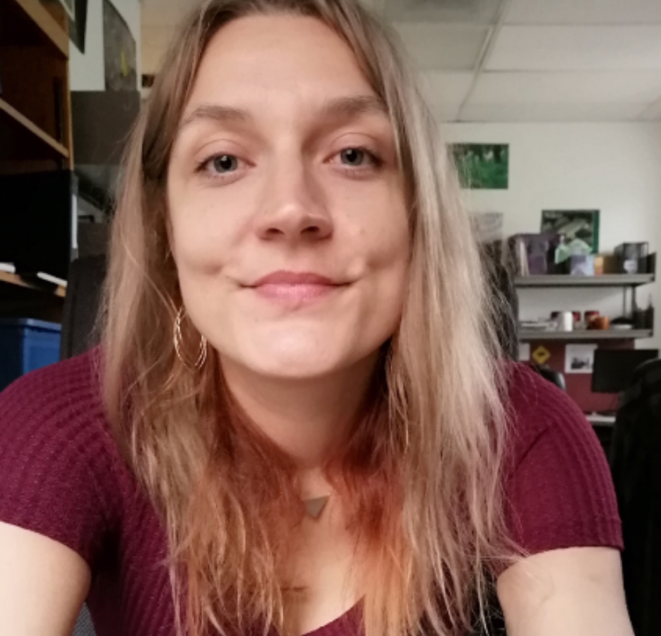{.alumni-photo loading="lazy"}

::: {.alumni-body}
### Joanna Handzlik, PhD

Postdoctoral Research Fellow

::: {.alumni-next}
NYU Langone
:::
:::
:::

::: {.alumni-entry}
{.alumni-photo loading="lazy"}

::: {.alumni-body}
### Kaitlynn Meis

Undergraduate Research Assistant

::: {.alumni-next}
Sanford Health
:::
:::
:::

::: {.alumni-entry}
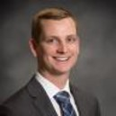{.alumni-photo loading="lazy"}

::: {.alumni-body}
### Brayden Groll

Undergraduate Research Assistant

::: {.alumni-next}
UND School of Medicine and Health Sciences
:::
:::
:::

::: {.alumni-entry}
{.alumni-photo loading="lazy"}

::: {.alumni-body}
### Madison Naylor

Technician

::: {.alumni-next}
Arkos Health
:::
:::
:::

::: {.alumni-entry}
{.alumni-photo loading="lazy"}

::: {.alumni-body}
### Emma Hoover

Undergraduate Research Assistant

::: {.alumni-next}
UND School of Medicine and Health Sciences
:::
:::
:::

::: {.alumni-entry}
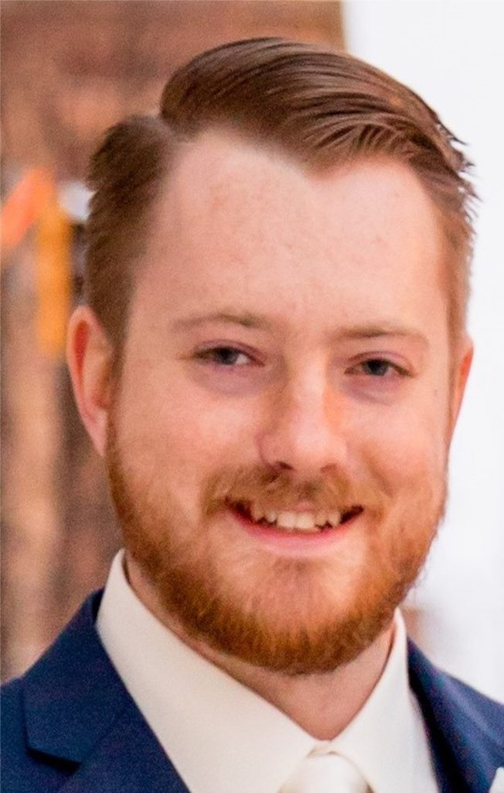{.alumni-photo loading="lazy"}

::: {.alumni-body}
### David Fehr

Undergraduate Research Assistant

::: {.alumni-next}
University of Iowa
:::
:::
:::

::: {.alumni-entry}
{.alumni-photo loading="lazy"}

::: {.alumni-body}
### Frances Kujawski

Undergraduate Research Assistant

::: {.alumni-next}
Merieux NutriSciences
:::
:::
:::

::: {.alumni-entry}
{.alumni-photo loading="lazy"}

::: {.alumni-body}
### Michelle Tuineau

Undergraduate Research Assistant

::: {.alumni-next}
ispot.tv
:::
:::
:::

::: {.alumni-entry}
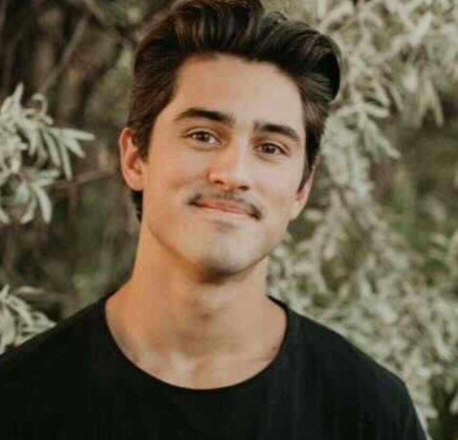{.alumni-photo loading="lazy"}

::: {.alumni-body}
### Rockford Copiskey

Undergraduate Research Assistant

::: {.alumni-next}
Bioinformatics and functional genomics
:::
:::
:::

:::
